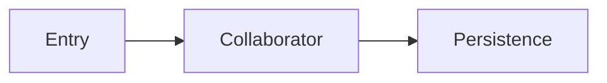

# Code Reading: <code area>

<What this area does and the recommended reading order.>

## Key files

- `path/to/file:line` — why it matters

## Evidence and unknowns

- **Fact:** <claim>
- **Inferred:** <claim>
- **Unknown:** <unconfirmed behavior>

— NiuNiu Tang
