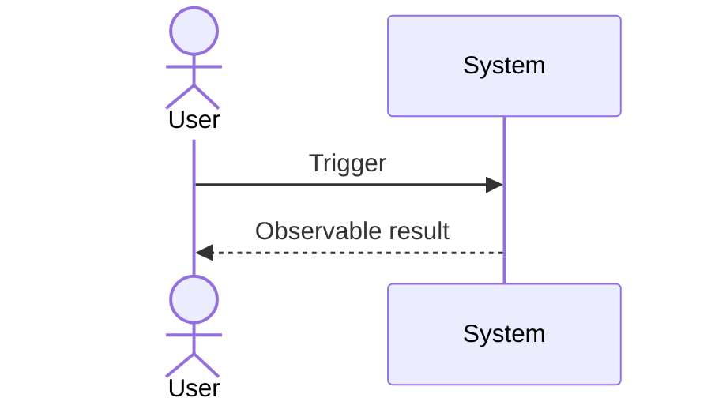

# Feature Trace: <feature>

<Short explanation from trigger to outcome.>

## Important steps

1. **<Step>** — `path/to/file:line`

## State and data

- <Only the state transition or data relationship needed to understand the flow.>

## Failure paths

- <Validation, permission, retry, or asynchronous behavior.>

## Unknowns

- <Not established by repository evidence.>

— NiuNiu Tang
