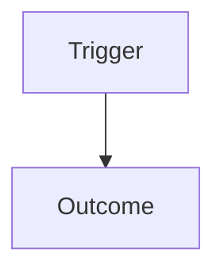

# Feature: <Name>

## Goal and Scope

<Problem, target users, outcomes, and boundary.>

## How to Read This Spec

<Actors, systems, and the main journey in a few sentences.>

## Behavior Walkthrough

1. <Trigger and normal path.>
2. <Decision or alternate path.>
3. <Completion, retry, recovery, or terminal outcome.>

## Pipeline / Workflow Model

| Stage | Entry condition | Input | Processing / decision | Output | Exit condition | Retry / resume point |
|---|---|---|---|---|---|---|
| <Stage 1> | <condition> | <input> | <what happens> | <output> | <condition> | <behavior> |

<Explain synchronous/asynchronous boundaries, checkpoints, joins, cancellation, expiration, and ownership transfer when relevant.>

## Transition Table

| From | Trigger | Guard | To | Observable result |
|---|---|---|---|---|
| <state> | <event> | <condition> | <state> | <result> |

## Visual Models

### <Question this diagram answers>

<Interpretation of the diagram and any simplifications.>

## Behavior / Requirements

- **R1:** <Observable requirement>

## Decision Rules

- <Condition> → <outcome>; precedence: <rule if applicable>.

## Model and Boundaries

<Entities, ownership, trust boundaries, and lifecycle only where relevant.>

## Examples and Edge Cases

- **AC1 / R1:** Given <context>, when <action>, then <result>.
- **AC2 / R1:** Given <failure or boundary condition>, when <action>, then <result>.

## Out of Scope

- <Explicit exclusion>

## Assumptions and Unknowns

- **Fact:** <Evidence-backed fact>
- **Inference:** <Reasonable interpretation>
- **Open question:** <Decision that materially changes behavior or scope>

— NiuNiu Tang
