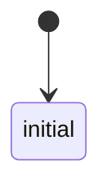
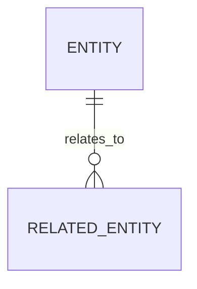

# State and Data Model: <entity>

<Short explanation of the lifecycle and/or data relationships.>

## Transitions and relationships

- `<state/event>` — `path/to/file:line`

## Invariants

- <Constraint supported by code or schema.>

## Unknowns

- <Not established by repository evidence.>

— NiuNiu Tang
